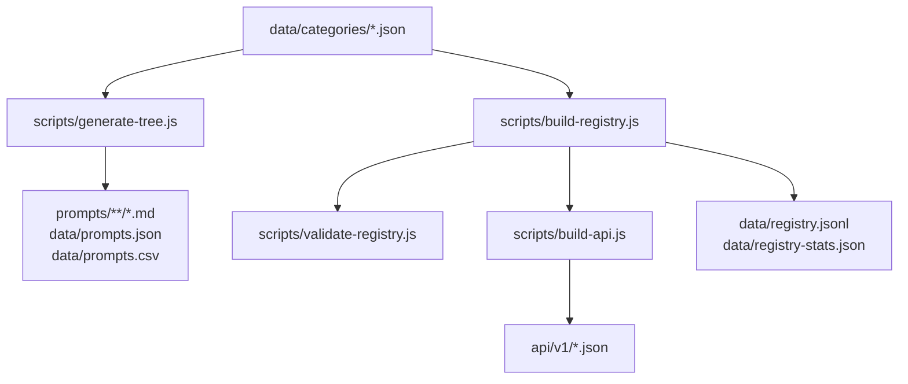

# Promptstack Architecture & Data Flow

This document outlines how Promptstack stores prompt records and builds public-facing data artifacts and API endpoints.

---

## 1. Canonical Content Source

The canonical source of truth for all prompts is:

```text
data/categories/{category-folder}.json
```

There are 19 category JSON files (e.g. `coding-development.json`, `ai-automation.json`, `business-career.json`). Each file contains an array of prompt records with 8 standardized fields:

```json
{
  "act": "Human-Readable Title",
  "category": "Display Category Name",
  "prompt": "Full prompt text with optional ${variable} placeholders",
  "source": "Attribution or author name",
  "type": "TEXT",
  "slug": "url-friendly-slug",
  "folder": "category-folder",
  "path": "prompts/category-folder/url-friendly-slug.md"
}
```

---

## 2. Build Pipeline & Data Flow

When category JSON files change, the build scripts generate and validate all downstream artifacts:



---

## 3. Derived Artifacts

Every derived file in the repository is generated deterministically from `data/categories/*.json`:

| File / Directory | Generated By | Purpose |
|---|---|---|
| `prompts/{folder}/{slug}.md` | `scripts/generate-tree.js` | Individual Markdown prompt files. |
| `prompts/{folder}/README.md` | `scripts/generate-tree.js` | Category index pages linking to individual prompts. |
| `data/prompts.json` | `scripts/generate-tree.js` | Master JSON array containing all prompt records. |
| `data/prompts.csv` | `scripts/generate-tree.js` | Spreadsheet export for Excel, Google Sheets, and pandas. |
| `data/registry.jsonl` | `scripts/build-registry.js` | Machine-readable registry (one JSON record per line) with content hashes and stable IDs. |
| `data/registry-stats.json` | `scripts/build-registry.js` | Record counts and category breakdown for badges and API status. |
| `api/v1/` | `scripts/build-api.js` | Static JSON API endpoints hosted on GitHub Pages. |

---

## 4. Local Build & Verification Commands

To regenerate and validate all derived files locally:

```bash
# 1. Regenerate Markdown tree, prompts.json, and prompts.csv from category JSONs
node scripts/generate-tree.js

# 2. Build machine-readable registry and statistics
node scripts/build-registry.js

# 3. Validate registry data integrity, ID uniqueness, and content hashes
node scripts/validate-registry.js

# 4. Compile static API endpoints in api/v1/
node scripts/build-api.js
```

---

## 5. Contributor Workflow

- **To add or update a prompt:** Submit changes to the appropriate `data/categories/{folder}.json` file.
- **Do not edit `prompts/**/*.md` directly:** Individual Markdown files are overwritten by the build script.
- Ensure prompt instructions are in English, actionable, include clear variables `${variable}`, and provide accurate source attribution.
